# YUM-YUM կայքի կառավարում. ուղեցույց

Կառավարման վահանակը բացվում է `կայքի-հասցե/admin` հասցեով, օրինակ՝
`https://yum-yum-donuts.vercel.app/admin`։ Աշխատում է և՛ համակարգչում, և՛ հեռախոսում։
Վահանակը հայերեն է, ներքևի ձախ անկյունում կարող եք փոխել անգլերենի։

> Նկարներում ցուցադրական տվյալներ են (փորձնական պատվերներ և աշխատակիցներ)։

---

## 1. Մուտք

1. Բացեք `/admin` էջը։
2. Գրեք ձեր **մուտքանունը** և **գաղտնաբառը**, սեղմեք **Մուտք**։
3. Առաջին մուտքի ժամանակ համակարգը կխնդրի ընտրել ձեր սեփական գաղտնաբառը։

Գաղտնաբառը մոռացե՞լ եք։ Ղեկավարը **Աշխատակիցներ** էջում կսահմանի նորը։

---

## 2. Գլխավոր էջ

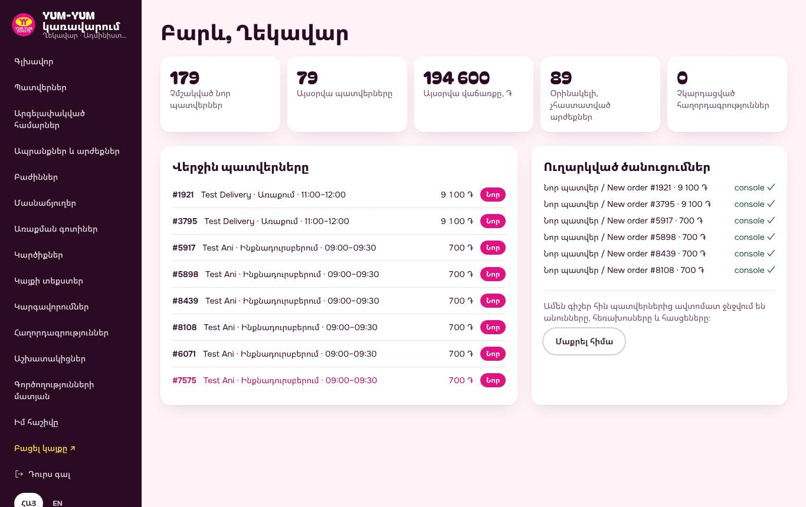

Վերևում՝ հինգ թիվ.

- **Չմշակված նոր պատվերներ.** պատվերներ, որոնց դեռ ոչ ոք չի զանգել։
- **Այսօրվա պատվերները** և **Այսօրվա վաճառքը**։
- **Օրինակելի, չհաստատված արժեքներ.** արժեքներ, որոնք պետք է ստուգել (տե՛ս 4-րդ բաժինը)։
- **Չկարդացված հաղորդագրություններ.** կայքից եկած նամակներ և միջոցառման հայտեր։

Ներքևում՝ վերջին պատվերները և ծանուցումները, որոնք ուղարկվել են Telegram-ով։

---

## 3. Պատվերներ. ամենօրյա աշխատանքը

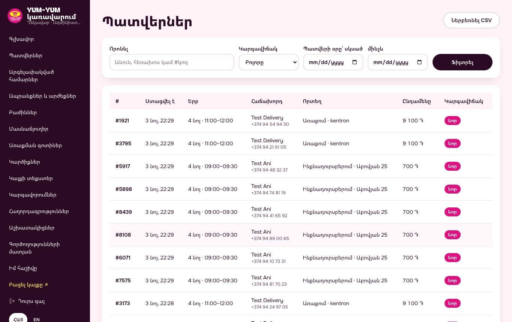

Նոր պատվերը գալիս է **Telegram-ով** և երևում է **Պատվերներ** էջում՝ **Նոր** նշումով։

### Ինչ անել նոր պատվերի հետ

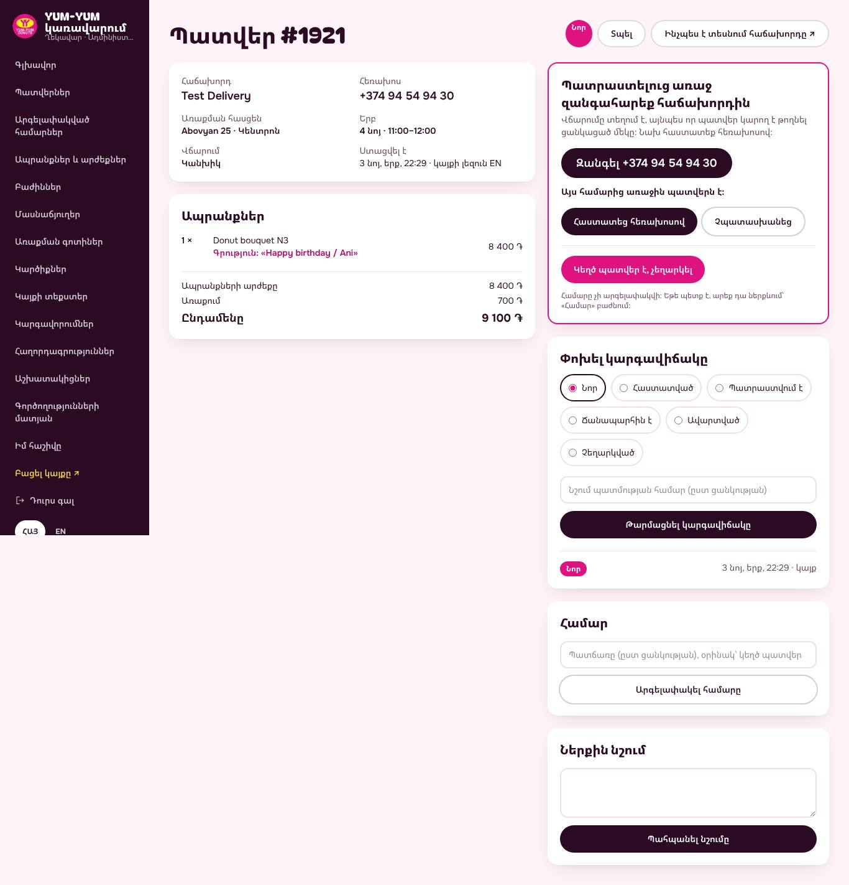

1. Բացեք պատվերը։ Վերևում կտեսնեք հաճախորդին, հեռախոսը, հասցեն, ժամը և վճարման ձևը։
2. **Պատրաստելուց առաջ զանգահարեք հաճախորդին.** սեղմեք **Զանգել** կոճակը։
   Վճարումը տեղում է, ուստի զանգը հաստատում է, որ պատվերն իրական է։
3. Զանգից հետո սեղմեք.
   - **Հաստատեց հեռախոսով**, եթե ամեն ինչ ճիշտ է,
   - **Չպատասխանեց**, եթե չպատասխանեց (կարող եք կրկին զանգել ավելի ուշ),
   - **Կեղծ պատվեր է, չեղարկել**, եթե պատվերը կեղծ է։
4. Աշխատանքի ընթացքում փոխեք **կարգավիճակը**.
   **Նոր → Հաստատված → Պատրաստվում է → Ճանապարհին է → Ավարտված**։
   Հաճախորդը իր հղումով տեսնում է կարգավիճակը (կոճակ **Ինչպես է տեսնում հաճախորդը**)։
5. **Ներքին նշում** դաշտում կարող եք գրել գործընկերների համար (հաճախորդը չի տեսնում)։

### Կեղծ պատվերներ

Եթե նույն համարից կեղծ պատվերներ են գալիս, պատվերի էջում սեղմեք **Արգելափակել համարը**։
Այդ համարից կայքը այլևս պատվեր չի ընդունի։ Ցանկը **Արգելափակված համարներ** էջում է,
այնտեղից էլ կարող եք հանել արգելքը։

### Հեռախոսով

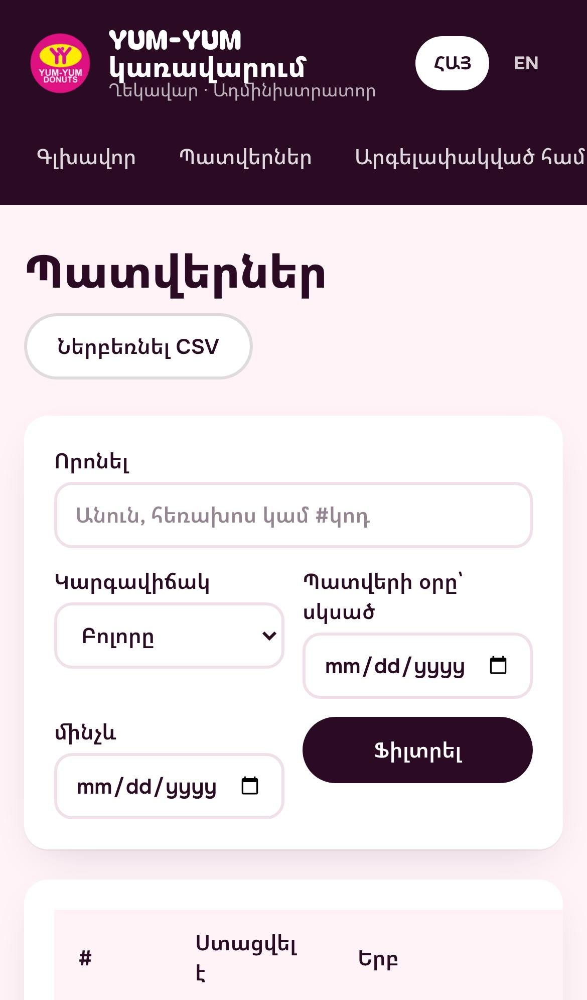

Վահանակը նույն կերպ աշխատում է հեռախոսում. հարմար է խանութում։

---

## 4. Ապրանքներ և արժեքներ

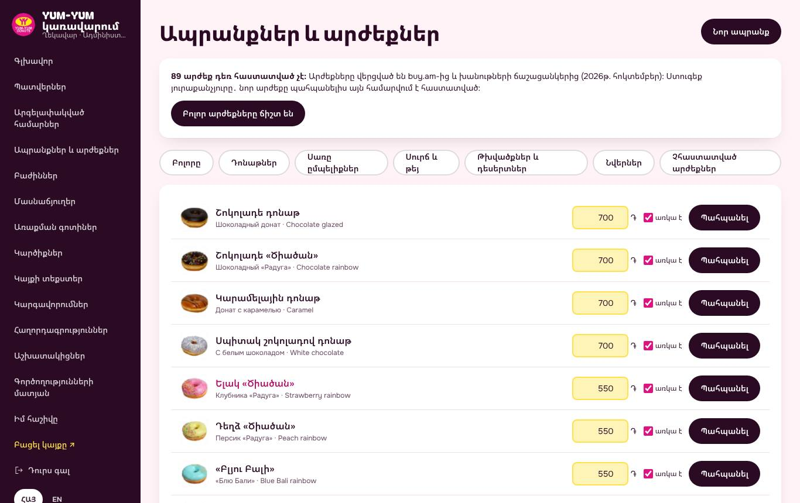

### Փոխել արժեքը

1. Գտեք ապրանքը (վերևի կոճակներով ընտրեք բաժինը)։
2. Դեղին դաշտում գրեք նոր արժեքը, սեղմեք **Պահպանել**։

### Ապրանքը վերջացե՞լ է

Հանեք **առկա է** նշումը և սեղմեք **Պահպանել**։ Ապրանքը կմնա կայքում, բայց պատվիրել
չի լինի։ Վաղը նորից նշեք։

### Չհաստատված արժեքներ

Ցուցադրական արժեքները վերցված են buy.am-ից և խանութների ցուցանակներից։ Ստուգեք
**Չհաստատված արժեքներ** ֆիլտրով։ Երբ բոլորը ճիշտ են, սեղմեք **Բոլոր արժեքները ճիշտ են**։

### Նոր ապրանք

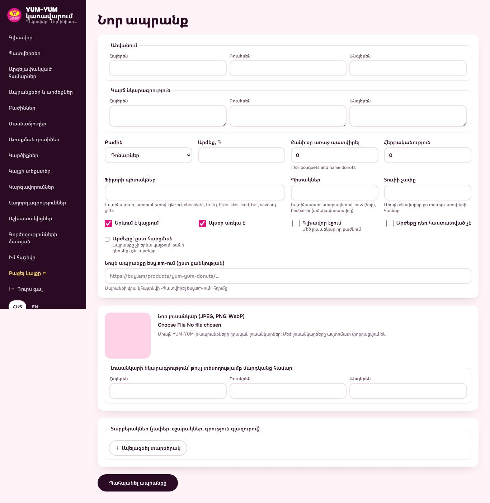

1. Սեղմեք **Նոր ապրանք**։
2. Լրացրեք **անվանումը** և **կարճ նկարագրությունը** երեք լեզվով (հայերեն պարտադիր է)։
3. Ընտրեք **բաժինը**, գրեք **արժեքը**։
4. **Քանի օր առաջ պատվիրել.** 0՝ նույն օրը, 1՝ փնջերի և անվանական դոնաթների համար։
5. Ավելացրեք **լուսանկար** (JPEG, PNG կամ WebP)։ Մեծ լուսանկարները ինքնաբերաբար
   փոքրացվում են։ Օգտագործեք միայն YUM-YUM-ի իրական լուսանկարներ։
6. **Տարբերակներ** (չափ, օշարակ, գրություն գլազուրով)՝ ըստ անհրաժեշտության։
7. Սեղմեք **Պահպանել ապրանքը**։

---

## 5. Բաժիններ, մասնաճյուղեր, առաքում

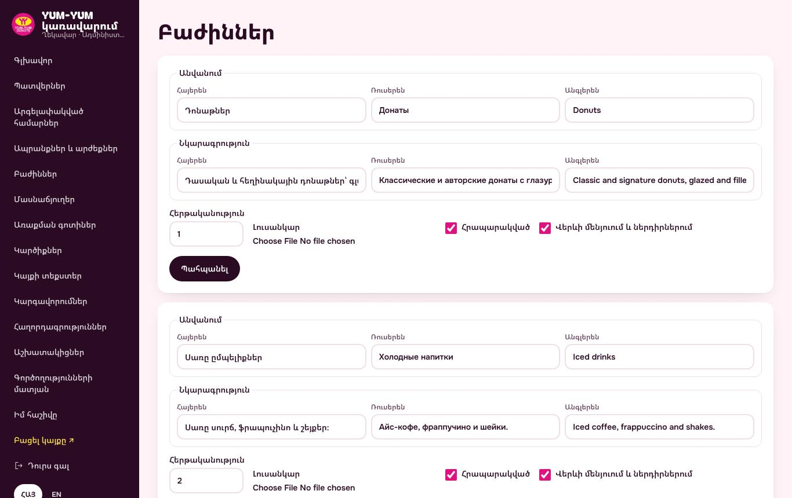

- **Բաժիններ.** ճաշացանկի բաժինների անունները, հերթականությունը և լուսանկարները։

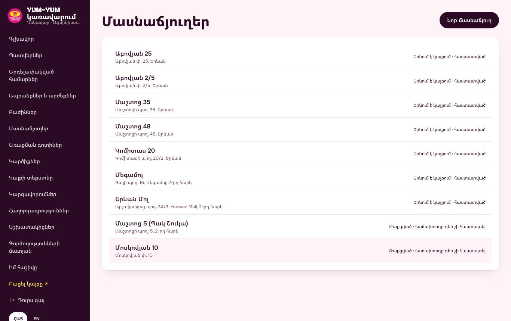

- **Մասնաճյուղեր.** հասցեն, ժամերը (յուրաքանչյուր օրվա համար), լուսանկարը, քարտեզի կետը։
  Փակ մասնաճյուղը կարող եք թաքցնել։

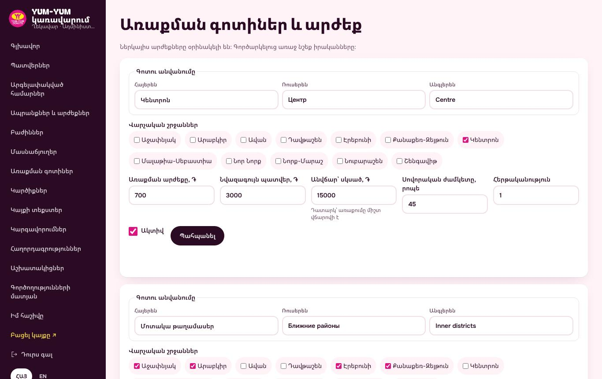

- **Առաքման գոտիներ.** թաղամասերը, առաքման արժեքը և նվազագույն պատվերը։

---

## 6. Հաղորդագրություններ և միջոցառման հայտեր

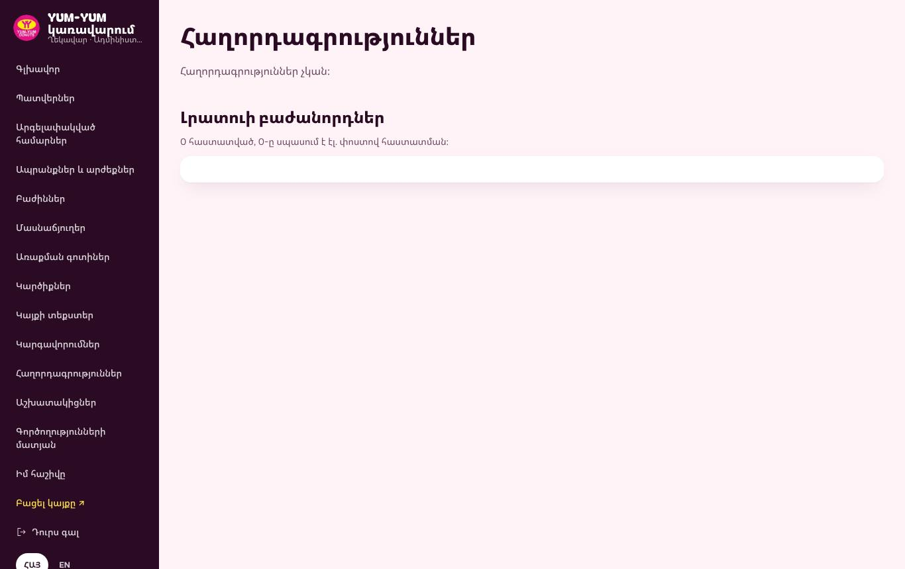

Այստեղ են գալիս.

- **Կապ** էջի նամակները,
- **Կորպորատիվ և միջոցառման պատվերների** հայտերը (ամսաթիվ, հյուրերի քանակ, ինչ է պետք)։

Յուրաքանչյուր հայտ գալիս է նաև Telegram-ով։ Զանգեք, պատասխանեք և նշեք որպես մշակված։

---

## 7. Աշխատակիցներ

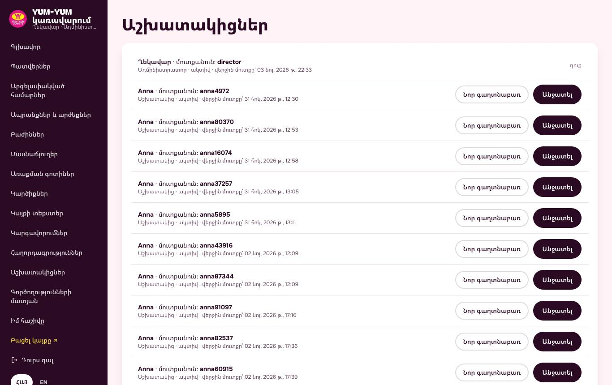

- **Նոր աշխատակից.** գրեք անունը, մուտքանունը և առաջին գաղտնաբառը։ Առաջին մուտքի ժամանակ
  աշխատակիցը կընտրի իր գաղտնաբառը։
- **Նոր գաղտնաբառ.** եթե աշխատակիցը մոռացել է։
- **Անջատել.** եթե աշխատակիցն այլևս չի աշխատում (մուտքն անմիջապես փակվում է)։

**Աշխատակից** դերը աշխատում է պատվերների, հաղորդագրությունների, արգելափակված համարների,
ապրանքների, արժեքների և առկայության հետ։
**Ադմինիստրատոր** դերը փոխում է նաև կարգավորումները, մասնաճյուղերը, բաժինները, առաքման
գոտիները, կարծիքները, կայքի տեքստերը և աշխատակիցներին, տեսնում է գործողությունների մատյանը։

---

## 8. Կարգավորումներ և կայքի տեքստեր

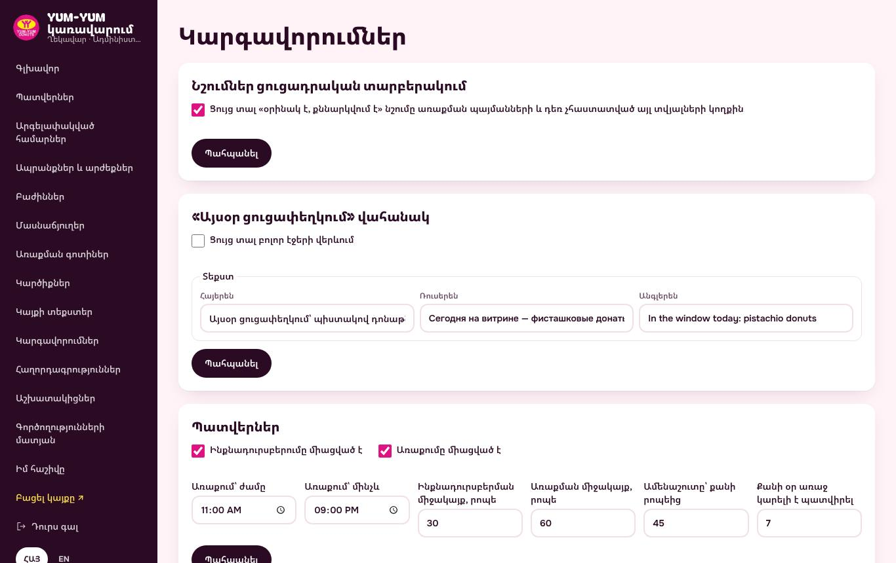

- **Նշումներ ցուցադրական տարբերակում.** հանեք, երբ առաքման պայմանները, վճարման ձևերը և
  հեռախոսները հաստատված են։ Այդ ժամանակ կայքից կվերանան «օրինակ է, քննարկվում է» նշումները։
- **«Այսօր ցուցափեղկում» վահանակ.** կարճ տող բոլոր էջերի վերևում (օրինակ՝ նոր համ, տոնական
  առաջարկ)։ Գրեք երեք լեզվով և նշեք **Ցույց տալ**։
- **Պատվերներ.** միացնել/անջատել ինքնադուրսբերումը և առաքումը, ժամերը, ամենաշուտը քանի
  րոպեից, քանի օր առաջ կարելի է պատվիրել։ Օրինակ՝ փակ օր, անջատեք պատվերները։
- **Կոնտակտներ.** հեռախոսներ, WhatsApp, Instagram։

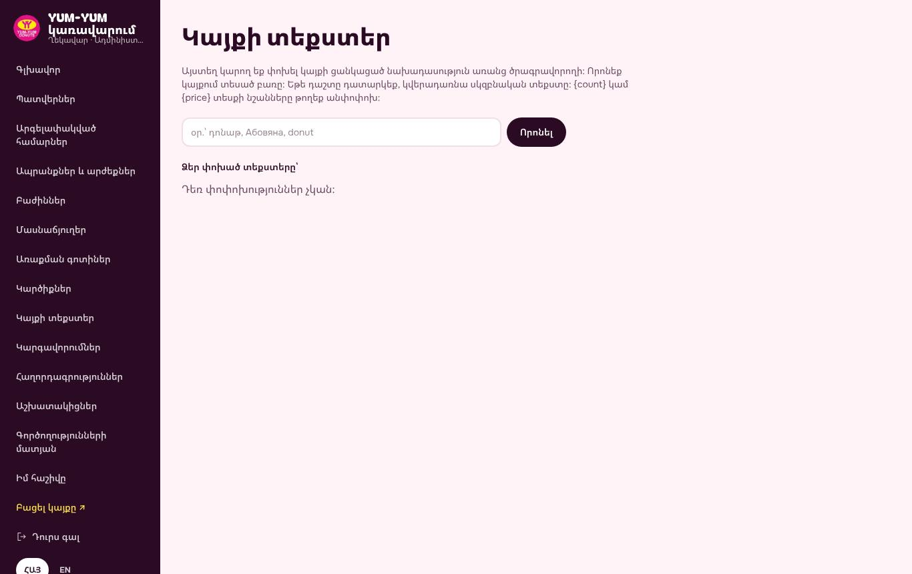

- **Կայքի տեքստեր.** գլխավոր էջի որոշ տեքստեր առանց ծրագրավորողի փոխելու համար։

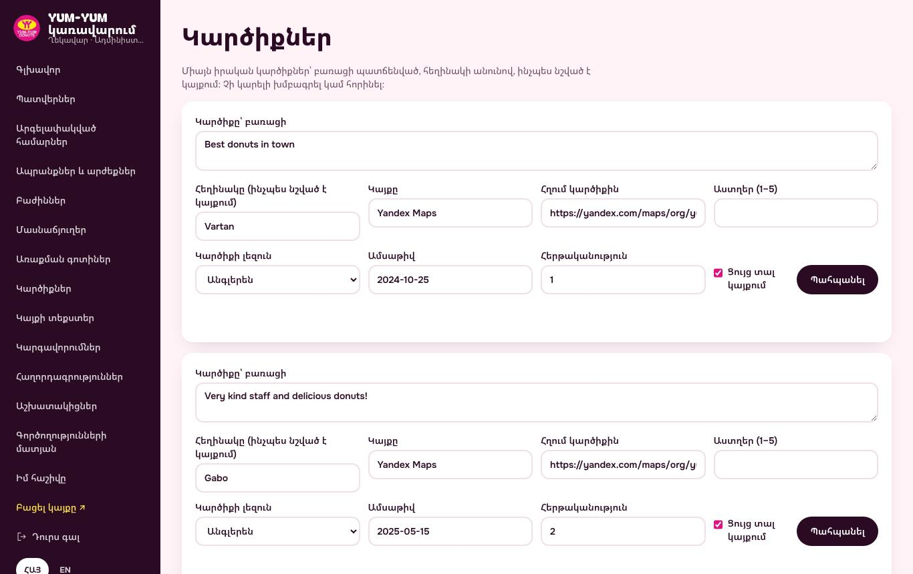

- **Կարծիքներ.** կայքում ցուցադրվող կարծիքները։ Ավելացրեք միայն իրական կարծիքներ՝ նշելով
  հեղինակին և աղբյուրը (Google, Instagram)։

---

## 9. Օգտակար է իմանալ

- **Գործողությունների մատյան.** ով, երբ և ինչ է փոխել։
- **Բացել կայքը ↗.** տեսնել կայքը այնպես, ինչպես հաճախորդը։
- Անձնական տվյալները (անուն, հեռախոս, հասցե) **ավտոմատ ջնջվում են** հին պատվերներից
  (Գլխավոր էջ → **Մաքրել հիմա**՝ անմիջապես)։
- Խնդիր կա՞։ Կայքի սխալները ինքնաբերաբար ուղարկվում են ծրագրավորողին Telegram-ով։
